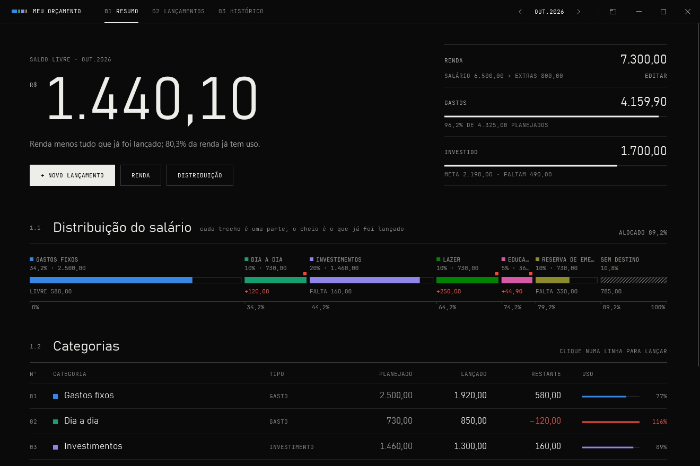
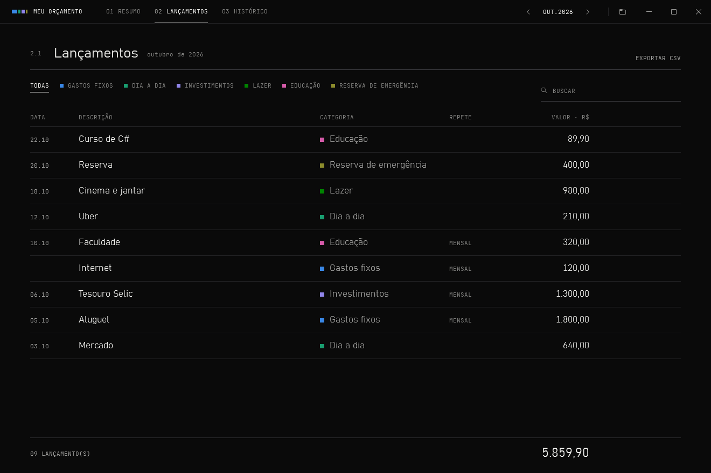
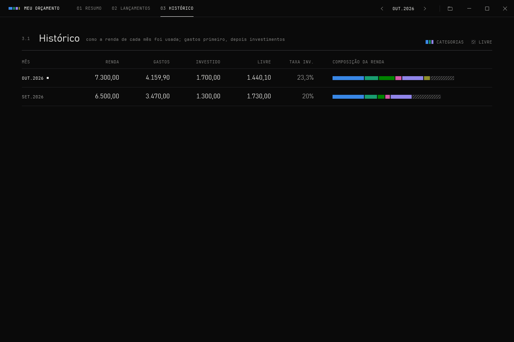
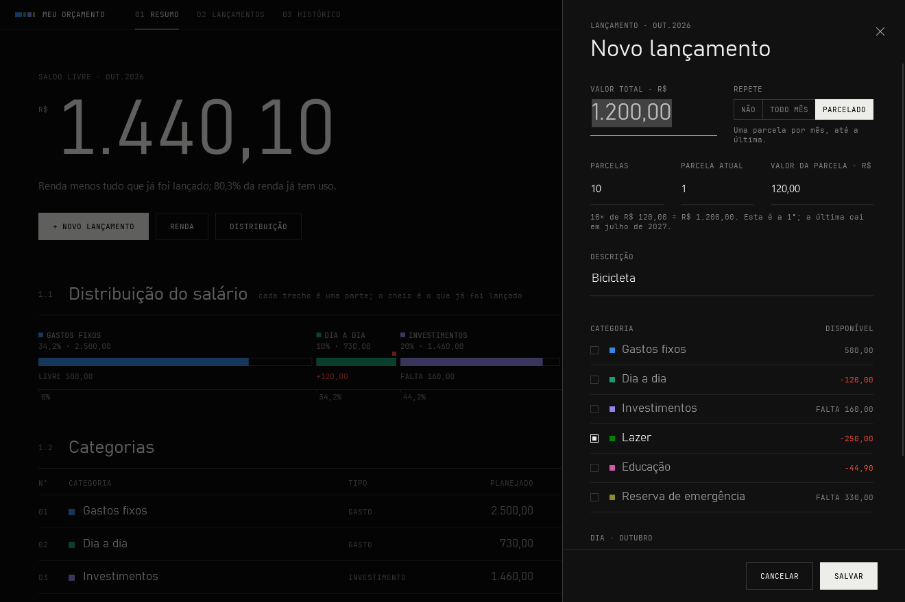
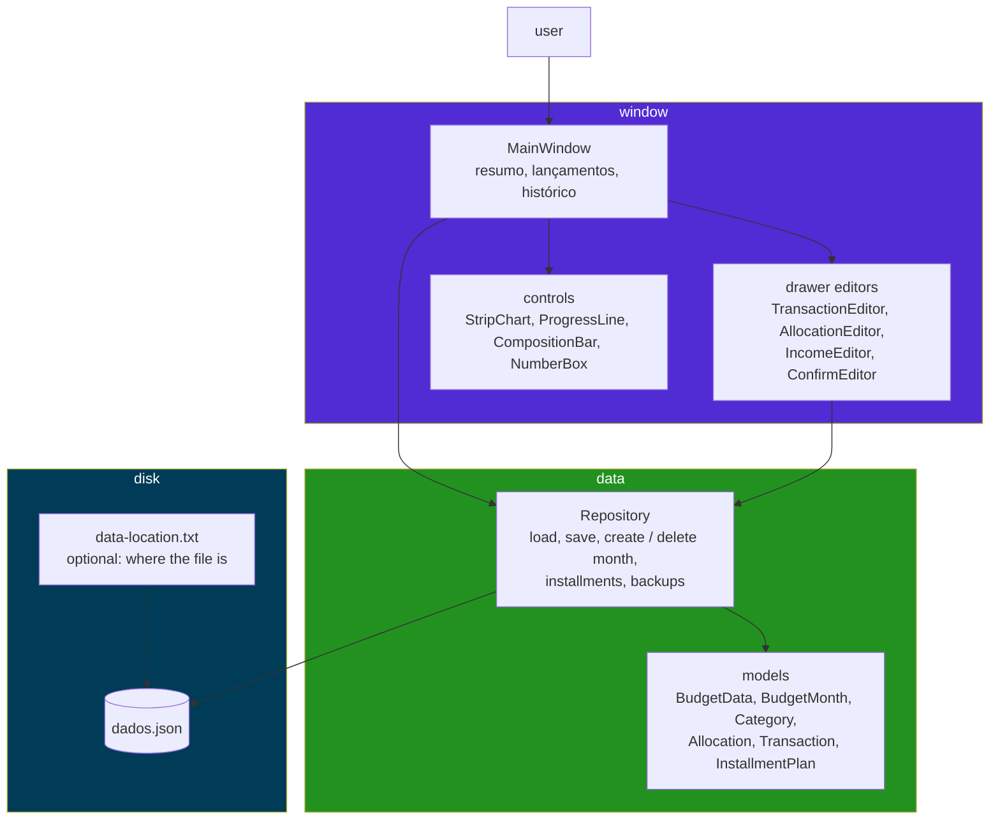

<div align="center">

<pre>
 ┌────────────────────────────────────────────────────┐
 │  user@dev:~/projects$ ./meuorcamento               │
 │                                                    │
 │      █████████████ ▓▓▓▓▓ ▒▒▒▒▒▒▒▒ ░░░░ //////      │
 │      █████████████ ▓▓▓▓▓ ▒▒▒▒▒▒▒▒ ░░░░ //////      │
 │      █████████████ ▓▓▓▓▓ ▒▒▒▒▒▒▒▒ ░░░░ //////      │
 │                                                    │
 │  > monthly budget · wpf + .net 10                  │
 └────────────────────────────────────────────────────┘
</pre>


</div>

---

## `$ cat about.txt`

```
meu orçamento ("my budget") is a windows desktop app that splits a
monthly income into categories (fixed costs, day to day, investments,
leisure...) and tracks what goes into each one, month by month.

everything lives in one json file. planning a new month copies the
previous one: the salary, the split, the recurring bills and the next
installment of every purchase paid in parts.

built as a hands-on study of c# and wpf, with no nuget packages: the
charts are drawn by hand in OnRender, and the tests run on a small
console runner that also renders every screen to a png. the code is in
english; the app itself speaks portuguese (pt-BR, R$).
```

## `$ open docs/screens/`



| transactions | history |
|---|---|
|  |  |



<sub>every screen above is rendered by the tests from fake data.</sub>

## `$ ls features/`

```
[x] split the income by % or by a fixed amount per category
[x] expenses and investments, with what is left per category and overspend in red
[x] transactions: one-off, monthly (recurring) or in installments (parcelado)
[x] installments move on to the following months and stop after the last one
[x] history: income, spent, invested and free per month, bar colored by category
[x] search and filter transactions, export a month to csv (opens in excel)
[x] one window per data file: opening it again brings the first one forward
[x] safe file: atomic save, a copy on conflict, a backup before deleting a month
[x] the data file can live anywhere, e.g. in onedrive, through a saved location
[ ] windows only, dark theme only
[ ] up to 7 categories per month, one color each
[ ] no undo: deleting a month keeps a backup file, not an undo button
[ ] every transaction is typed in by hand
```

## `$ cat stack.lock`

```
runtime     .net 10 (net10.0-windows), c#
framework   wpf, code-behind (no mvvm framework)
storage     one json file via System.Text.Json
charts      hand-drawn FrameworkElements (OnRender), no chart library
fonts       jetbrains mono nl (embedded, ofl) + bahnschrift and segoe ui (windows)
packages    none
tests       custom console runner: 109 checks + a png of every screen
tooling     dotnet cli / visual studio
```

## `$ cat architecture.mmd`



## `$ ./install.sh`

```bash
# clone
git clone https://github.com/miguelcrwz/meuorcamento.git
cd meuorcamento

# needs windows and the .net 10 sdk; there are no packages to restore
dotnet build
```

## `$ ./run`

```powershell
# development
dotnet run

# a single .exe (~750 kb, needs the .net 10 desktop runtime)
dotnet publish MeuOrcamento.csproj -c Release -r win-x64 --self-contained false -p:PublishSingleFile=true -o publish
.\publish\MeuOrcamento.exe

# try it on another data file, without touching yours
.\publish\MeuOrcamento.exe --dados C:\temp\teste.json
```

## `$ cat where-is-my-data.txt`

```
default     %APPDATA%\MeuOrcamento\dados.json

elsewhere   write the file's full path, one line, in
            %APPDATA%\MeuOrcamento\data-location.txt
            and the app opens that file instead (e.g. one kept in onedrive).
            if it is not there, the app says so and quits instead of
            starting empty

one-off     --dados <file> wins over both

backups     next to the data file:
            dados.antes-de-excluir-<month>.<time>.json   before deleting a month
            dados.conflito.<time>.json                   the file changed outside the app
            dados.corrompido.<time>.json                 the file could not be read
```

## `$ describe dados.json`

```
the keys stay in portuguese, so files saved by earlier versions keep opening

Versao
Categorias      Id, Nome, Tipo (Gasto | Investimento), Cor (0-6)
Meses           Chave (yyyy-MM), Salario, RendaExtra
  Alocacoes     CategoriaId, Percentual, ValorFixo (optional, in R$)
  Lancamentos   Id, Data, Descricao, Valor, CategoriaId, Recorrente,
                Parcelamento (only on installments):
                  Compra    the purchase id, shared by all its installments
                  Parcela   this installment's number
                  Parcelas  how many there are
                  Total     the purchase total
```

## `$ cat installments.flow`

```
a R$ 1.200,00 purchase in 10x, the 1st one in october
  │
  ├─ oct   1 de 10   R$ 120,00   the 1st one absorbs any rounding cents
  ├─ nov   2 de 10   R$ 120,00   planning a month copies the next installment
  ├─ ...
  └─ jul  10 de 10   R$ 120,00   after the last one, nothing else is copied

edit it     ─> the months already planned after this one are rewritten
delete it   ─> this one and the following ones go; earlier months keep theirs
```

## `$ ./test.ps1`

```powershell
.\test.ps1          # every check; reports and screens in Tests\output\
.\test.ps1 -Real    # also renders the screens of a COPY of your own data file
```

```
109 passed · 0 failed
```

the test data is fake and the tests never open your `dados.json`. the font audit fails any text outside the type scale. more in [`Tests/README.md`](Tests/README.md).

## `$ tree`

```
meuorcamento/
├── Controls/              # NumberBox, Charts (strip, progress line, composition bar)
├── Editors/               # the drawer's forms: transaction, allocation, income, confirm
├── Themes/                # Dark.xaml (colors), Styles.xaml (type scale and styles)
├── Fonts/                 # jetbrains mono nl + its OFL.txt
├── Tests/                 # console test runner, see Tests/README.md
├── docs/screens/          # the screenshots above
├── App.xaml(.cs)          # startup: which data file, one window per file
├── MainWindow.xaml(.cs)   # the three pages and the drawer
├── Models.cs              # BudgetData, BudgetMonth, Category, Transaction...
├── Repository.cs          # load, save, months, installments, backups
├── Rows.cs                # what each table row shows
├── Format.cs              # how money, months and dates show up on screen
├── CategoryColors.cs      # the 7 category colors
├── NativeWindow.cs        # dark frame and corners through windows (dwm)
├── test.ps1
├── LICENSE
└── README.md
```

## `$ git log --oneline roadmap`

```
a1b2c3d  feat: one category across months, spent per month and trend
e4f5g6h  feat: investments accumulated over time
i7j8k9l  feat: undo right after deleting a transaction or a month
m0n1o2p  feat: carry a month's leftover into the next one
q3r4s5t  chore: move the window logic to mvvm and the tests to xunit
```

## `$ cat LICENSE | head -1`

```
MIT © 2026 Miguel Cruz
```

the embedded jetbrains mono nl font is under the sil open font license 1.1, see [`Fonts/OFL.txt`](Fonts/OFL.txt).

## `$ whoami`

```
miguel cruz
├── github    https://github.com/miguelcrwz
├── linkedin  https://linkedin.com/in/miguelcrwz
└── email     miguwlcrwz@gmail.com
```

<div align="center">

<pre>
$ exit
[process exited with code 0]
</pre>

</div>
